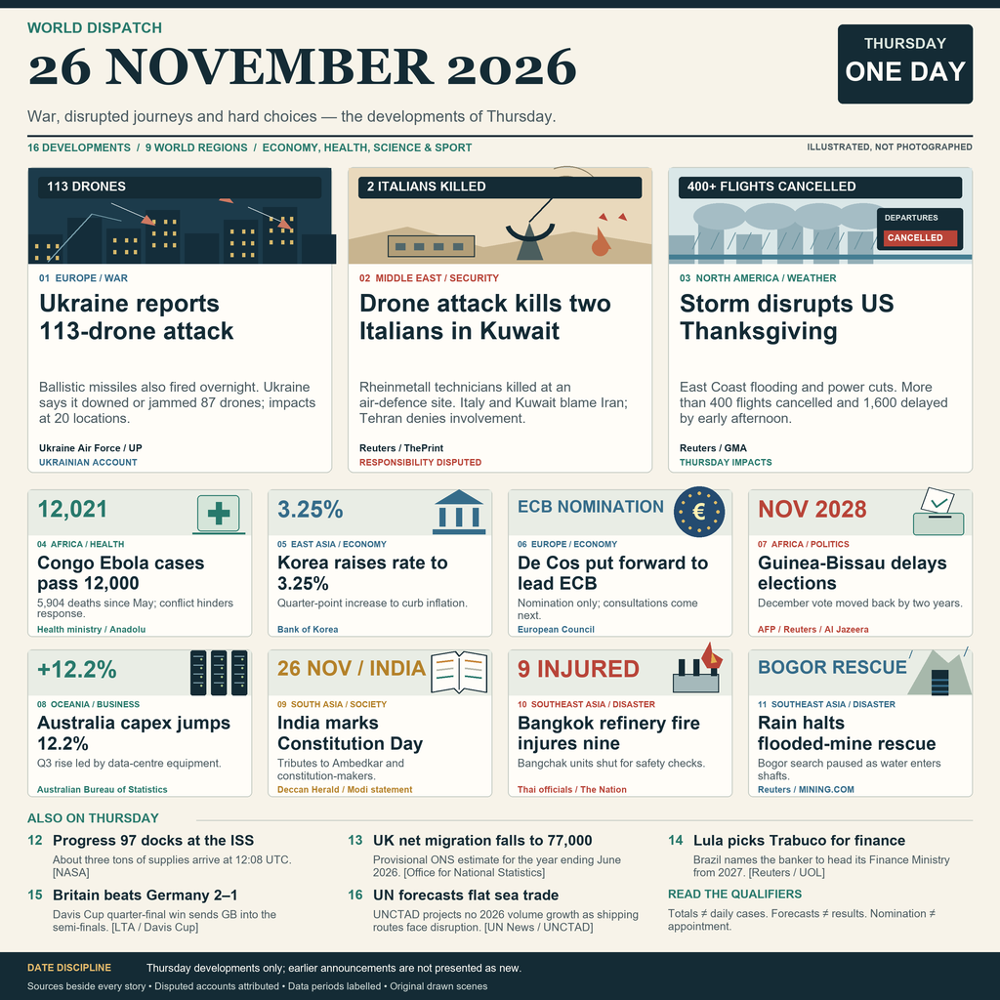

# World Dispatch — Thursday 26 November 2026

[](https://make.fun/bounty/news-image-20261126)
[](https://make.fun/bounty/news-image-20261126/leaderboard)
[](https://make.fun/bounty/news-image-20261126)

**Published revision candidate. Not yet submitted or graded by make.fun.** The badges refer to this repository's existing make.fun entries, not a score earned by this revision.

An original illustrated editorial page with 16 developments across nine terrestrial regions, plus space and global trade. Three lead scenes are followed by eight illustrated modules and five briefs. Sources are identified on the image and documented, with dates and editorial qualifications, in `source-ledger.json`.



## Run

Requires Node 22.18 or later; no packages or network access.

```sh
MAKEFUN_OUTPUT_DIR=out node main.ts
```

The entrypoint validates the bundled PNG's signature, dimensions, size and end marker, then writes identical bytes to `entry.png` in the output directory (default `/output`). The static artwork makes font rendering and network services unnecessary inside the sandbox.

## Editorial handling

- Ukrainian attack figures are explicitly attributed.
- Iran's denial appears alongside Italy and Kuwait's attribution.
- The US weather story reports Thursday impacts, not a new parade-postponement decision.
- Ebola totals are cumulative; quarterly and annual data periods are labelled.
- ECB candidacy remains a nomination; UN shipping figures remain a forecast.
- Thursday's Indonesian rescue halt is distinguished from Monday's initial flooding.

The reference images supplied for comparison are not included or reused in the artwork. Scenes are drawn illustrations, not documentary photographs.

## Verification and submission status

Local format and deterministic-execution checks are stored outside the candidate. These are not make.fun grading results. A safe, correctly scoped transcript bundle and official checks are prerequisites to submission; no rank or prize is promised.

MIT licensed. Bounty: https://make.fun/bounty/news-image-20261126
